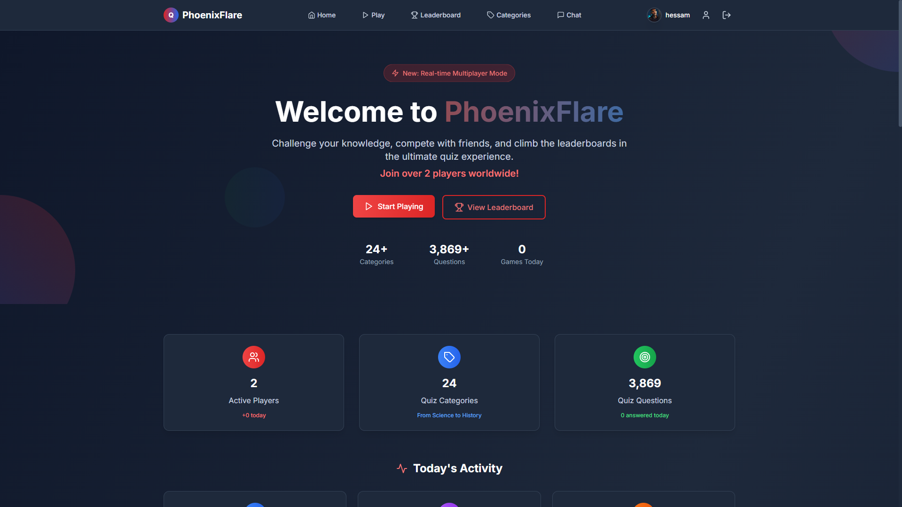
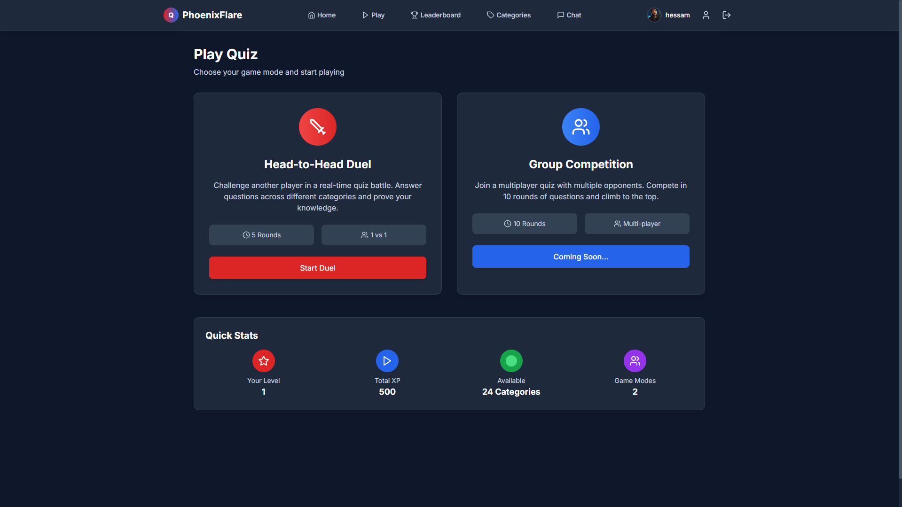
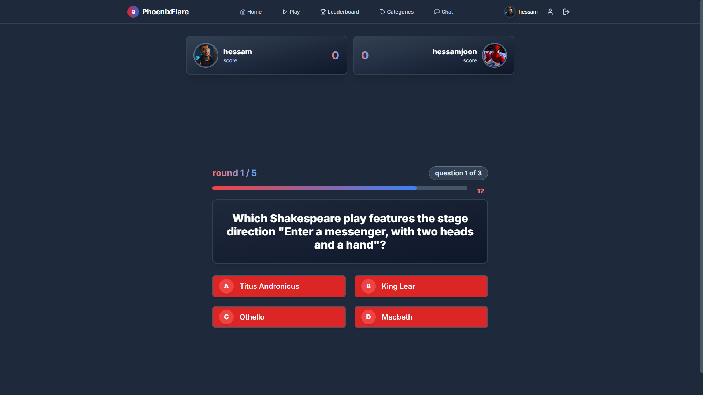
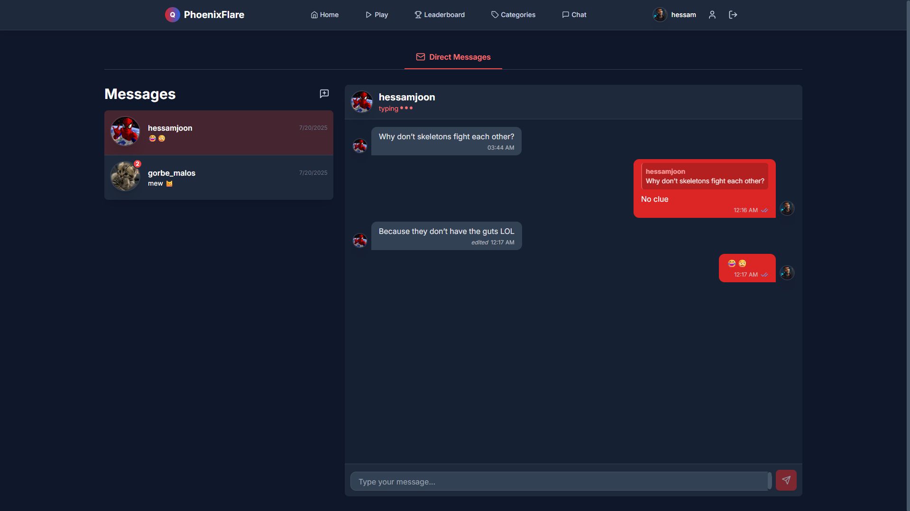
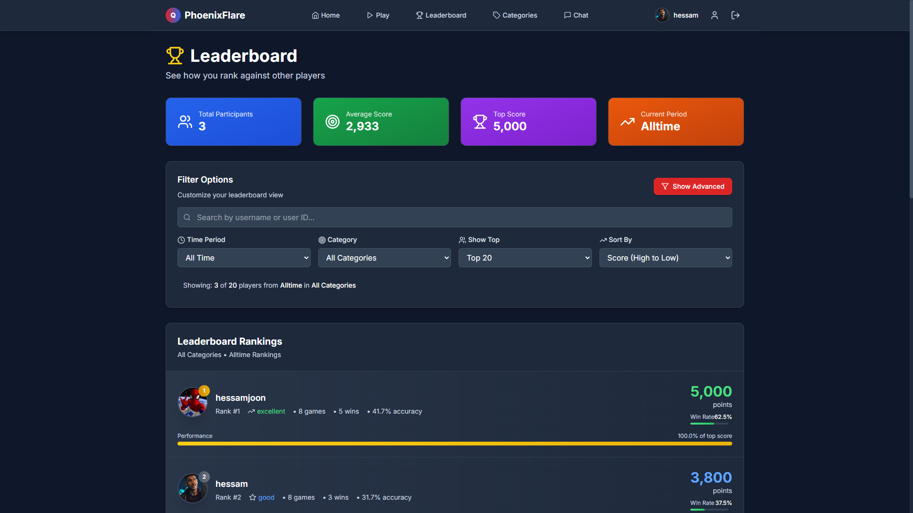
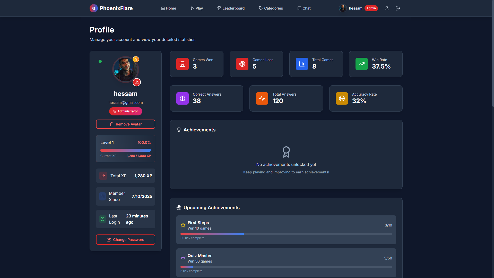

# PvPQuizApp

A full-stack **real-time multiplayer trivia application** where players can compete in quiz matches, chat, track statistics, and climb leaderboards.

The project combines a Flask/PostgreSQL backend with a React + TypeScript frontend and uses Socket.IO for live game and chat updates.

## Features

- User registration, login, and profiles
- Multiple quiz game types
- Matchmaking queue and multiplayer game sessions
- Category-based rounds and questions
- Real-time game updates with Socket.IO
- Public, private, and game chat
- Player and category statistics
- Leaderboards
- Question/category management endpoints
- Bulk question import
- Database integrity utilities

## Screenshots

<table>
  <tr>
    <td></td>
    <td></td>
  </tr>
  <tr>
    <td></td>
    <td></td>
  </tr>
  <tr>
    <td></td>
    <td></td>
  </tr>
</table>

## Tech stack

### Backend

- Python
- Flask
- Flask-Login
- Flask-SocketIO
- PostgreSQL / psycopg2
- Flask-CORS

### Frontend

- React 18
- TypeScript
- Vite
- React Router
- Tailwind CSS
- Axios
- Socket.IO Client
- Zod

## Architecture

```text
React + TypeScript
       |
       | HTTP / JSON
       v
     Flask
       |
       +-------- PostgreSQL
       |
       +-------- Flask-SocketIO
                     |
                     +-- game rooms
                     +-- chat events
```

The PostgreSQL schema includes users, categories, questions, game types, games, participants, matchmaking queues, rounds, answers, chat rooms/messages, player statistics, and leaderboards.

## Getting started

### Prerequisites

- Python 3.8+
- Node.js and npm
- PostgreSQL

### Clone

```bash
git clone https://github.com/Hessam-Hosseinian/PvPQuizApp.git
cd PvPQuizApp
```

### Backend

Create and activate a virtual environment, then install dependencies:

```bash
python -m venv .venv
source .venv/bin/activate
pip install -r requirements.txt
```

On Windows:

```powershell
.venv\Scripts\activate
```

Create a `.env` file:

```env
SECRET_KEY=replace-me
DB_HOST=localhost
DB_PORT=5432
DB_NAME=quizdb
DB_USER=postgres
DB_PASSWORD=replace-me
```

Start the backend:

```bash
python app.py
```

The server runs on:

```text
http://localhost:5000
```

A health endpoint is available at `/health`.

### Import questions

The repository includes a bulk import script and OpenTDB-derived data:

```bash
python import_questions.py
```

### Frontend

```bash
cd frontend
npm install
npm run dev
```

Vite normally serves the frontend at:

```text
http://localhost:5173
```

## Project structure

```text
.
├── app.py
├── config.py
├── app/
│   ├── routes/
│   ├── sql/
│   └── db.py
├── frontend/
│   └── src/
├── opentdb_data2/
├── tests/
├── import_questions.py
└── db_integrity_check.py
```

## Database

The schema in `app/sql/schema.sql` uses PostgreSQL-specific features including:

- `BIGSERIAL`
- PL/pgSQL functions
- triggers
- materialized views
- indexes for gameplay/chat queries

The application initializes its schema when the Flask app starts.

## Development checks

Backend tests:

```bash
pytest
```

Frontend:

```bash
cd frontend
npm run lint
npm run build
```

## Status

This is an academic/portfolio project. It contains a fairly broad feature set, but deployment/security configuration should be reviewed before exposing it to the public internet.

## License

No license file is currently present in the repository.
